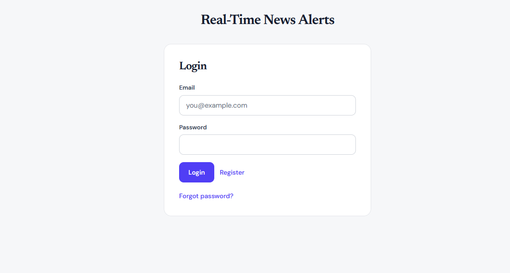
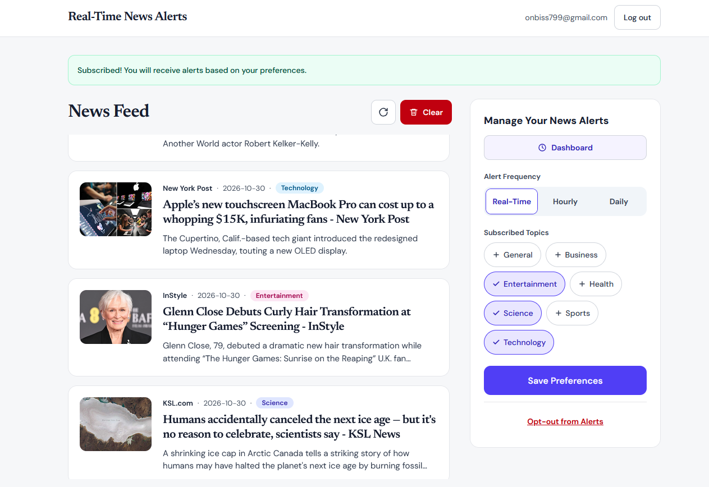
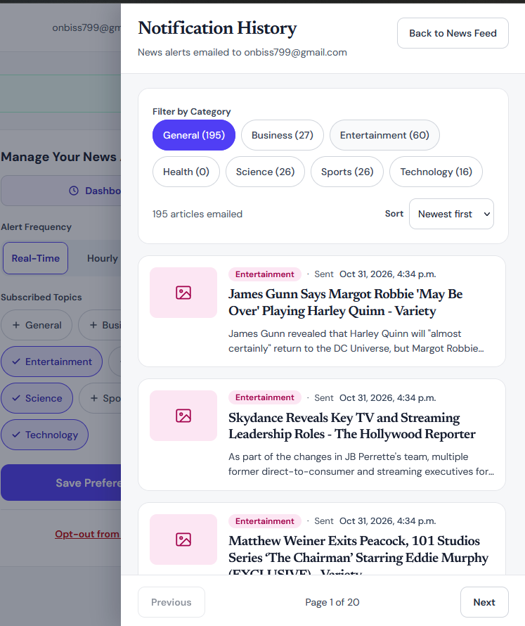

# Real-Time News Alerts

A full-stack MERN application that delivers news alerts by email. Users register, choose the news categories they care about and how often they want to hear about them (real-time, hourly or daily), and the server emails them fresh headlines. A dashboard keeps a searchable history of every alert that was sent.

---

## Table of Contents

1. [Overview](#overview)
2. [Features](#features)
3. [Technologies Used](#technologies-used)
4. [How It Works](#how-it-works)
5. [Project Structure](#project-structure)
6. [Installation](#installation)
7. [Environment Configuration](#environment-configuration)
8. [Screenshots](#screenshots)
9. [API Documentation](#api-documentation)
10. [Deployment](#deployment)
11. [Known Limitations](#known-limitations)
12. [Author](#author)

---

## Overview

Staying on top of the news usually means checking several sites. This project flips that around: users pick their topics once, and relevant headlines arrive in their inbox on the schedule they choose.

- Browse the latest headlines by category inside the app.
- Save alert preferences (categories and frequency).
- Receive alert emails automatically.
- Review every alert ever sent from the dashboard, with filtering, sorting and pagination.

The backend checks for due alerts **every minute**, so a user on "Real-Time" gets an email as soon as new articles are found, "Hourly" users get one every 60 minutes, and "Daily" users one every 24 hours.

---

## Features

**Alerts and notifications**
- Email alerts with a list of linked headlines (HTML and plain-text versions).
- Three alert frequencies: **Real-Time**, **Hourly** and **Daily**.
- No repeated articles: a headline already emailed to a user is never sent to them again.
- Up to 10 new articles per email.
- Alerts are sent only to users who are subscribed **and currently signed in**.

**Personalisation**
- Choose from seven categories: business, entertainment, general, health, science, sports and technology.
- Change categories and frequency at any time, or opt out of alerts completely.

**News feed**
- Live news feed by category, merged and sorted newest first.
- Refresh and clear controls.

**Dashboard**
- Full history of emailed articles.
- Filter by category with per-category counts, sort newest or oldest first, and page through results.

**Accounts**
- Register, log in and log out.
- Forgot password with an emailed reset link (valid for 1 hour), plus change password.
- Passwords are hashed with bcrypt.

**Reliability**
- Per-category caching so the news provider is not hit on every check.
- Failed fetches back off and fall back to the last good copy.
- One failing user or category never stops the others.
- Overlapping job runs are prevented, so no duplicate emails.

---

## Technologies Used

| Layer | Technology |
|---|---|
| Frontend | React (Vite), Tailwind CSS |
| Backend | Node.js, Express |
| Database | MongoDB with Mongoose |
| Scheduling | node-cron |
| Email | Gmail API (OAuth 2.0) over HTTPS, MIME built with Nodemailer's mail composer |
| News data | [NewsAPI](https://newsapi.org) top headlines |
| HTTP client | Axios |
| Security | bcryptjs password hashing, hashed password-reset tokens |
| Deployment | Render (backend), Vercel (frontend) |

---

## How It Works

```
 ┌────────────┐      HTTPS/JSON       ┌──────────────────────────────┐
 │  React app │ ────────────────────▶ │  Express API  (/api/...)     │
 │  (Vercel)  │ ◀──────────────────── │  (Render)                    │
 └────────────┘                       │                              │
                                      │  node-cron: runs every minute│
                                      │   1. find subscribed users   │
                                      │      who are signed in       │
                                      │   2. is their alert due?     │
                                      │   3. fetch + cache news      │
                                      │   4. drop already-sent items │
                                      │   5. send email (Gmail API)  │
                                      │   6. save history            │
                                      └───────┬───────────────┬──────┘
                                              │               │
                                       ┌──────▼─────┐   ┌─────▼──────┐
                                       │  MongoDB   │   │  NewsAPI   │
                                       └────────────┘   └────────────┘
```

---

## Project Structure

```
.
├── server.js                  # App entry: middleware, routes, starts the alert job
├── package.json
├── .env.example               # Template for environment variables
└── src/
    ├── config/
    │   └── db.js              # MongoDB connection
    ├── constants/
    │   └── newsCategories.js  # Allowed categories
    ├── Controllers/           # NOTE: capital "C" - folder names are case-sensitive on Linux
    │   ├── categoryController.js
    │   └── dashboardController.js
    ├── jobs/
    │   └── newsJob.js         # Cron job that sends the alert emails
    ├── models/
    │   ├── User.js
    │   ├── Notification.js
    │   ├── NewsArticle.js
    │   └── Category.js
    ├── routes/
    │   ├── userRoutes.js      # Auth, preferences, subscribe, notifications
    │   ├── newsRoutes.js      # News feed
    │   ├── dashboardRoutes.js # History and summary
    │   └── categoryRoutes.js
    └── services/
        ├── newsService.js     # NewsAPI client + article caching in MongoDB
        └── emailService.js    # Gmail API sender and email templates

frontend/
├── index.html
├── package.json
└── src/
    ├── main.jsx
    ├── App.jsx                
    ├── api.js                 
    ├── categories.js          
    ├── index.css              
    └── components/
        ├── Dashboard.jsx
        ├── NewsFeed.jsx
        ├── NotificationHistoryDrawer.jsx
        ├── SubscribeForm.jsx
        ├── AuthComponents.jsx
        ├── LoginPage.jsx
        ├── RegisterPage.jsx
        ├── ForgotPasswordPage.jsx
        ├── ResetPasswordPage.jsx
        └── ChangePasswordPage.jsx
```

---

## Installation

### Prerequisites

- Node.js 24.x (see `engines` in `package.json`) and npm
- A MongoDB database (a free [MongoDB Atlas](https://www.mongodb.com/atlas) cluster works well)
- A free [NewsAPI](https://newsapi.org) key
- A Google Cloud project with the Gmail API enabled (see [Gmail API setup](#gmail-api-setup))

### 1. Clone the repository

```bash
git clone <your-repository-url>
cd <your-repository-folder>
```

### 2. Set up the backend

```bash
npm install
cp .env.example .env
npm run dev
npm start
```

The API starts on `http://localhost:5000`. Opening it in a browser shows `News Alert API is running`.

### 3. Set up the frontend

```bash
cd frontend
npm install
```

Create `frontend/.env`:

```env
VITE_API_URL=http://localhost:5000/api
```

Then start it:

```bash
npm run dev
```

Open the URL Vite prints (normally `http://localhost:5173`).

### 4. Try it out

1. Open `/register` and create your own account.
2. Log in, pick a few categories and a frequency, and press **Save Preferences**.
3. Within a minute or two you should receive an alert email. Check your spam folder if you don't see it.
4. Open **Dashboard** to see the history.

> Tip: set `RUN_ALERT_ON_START=true` in the backend `.env` to run one alert check as the server starts, and `NEWS_JOB_DEBUG=true` to see every decision the job makes.

---

## Environment Configuration

### Backend (`.env`)

| Variable | Required | Description |
|---|---|---|
| `PORT` | No | Port for the API. Defaults to `5000`. |
| `MONGODB_URI` | Yes | MongoDB connection string. |
| `NEWS_API_KEY` | Yes | Your NewsAPI key. |
| `EMAIL_USER` | Yes | The Gmail address that sends the alerts. |
| `GOOGLE_CLIENT_ID` | Yes | OAuth client ID from Google Cloud. |
| `GOOGLE_CLIENT_SECRET` | Yes | OAuth client secret. |
| `GOOGLE_REFRESH_TOKEN` | Yes | Refresh token with the `gmail.send` scope. |
| `EMAIL_FROM_NAME` | No | Sender display name. Defaults to `News Alerts`. |
| `CLIENT_URL` | Yes | Frontend URL, used in password-reset links (e.g. `http://localhost:5173`). |
| `NEWS_CACHE_MINUTES` | No | How long fetched news is reused. Defaults to `15`. |
| `NEWS_JOB_DEBUG` | No | `true` prints detailed job logs. |
| `RUN_ALERT_ON_START` | No | `true` runs one alert check when the server starts. |

Example `.env.example` (placeholders only, never commit real values):

```env
PORT=5000
MONGODB_URI=your_mongodb_connection_string

NEWS_API_KEY=your_news_api_key

EMAIL_USER=your_gmail_address
GOOGLE_CLIENT_ID=your_google_oauth_client_id
GOOGLE_CLIENT_SECRET=your_google_oauth_client_secret
GOOGLE_REFRESH_TOKEN=your_google_refresh_token
EMAIL_FROM_NAME=News Alerts

CLIENT_URL=http://localhost:5173

# Optional
NEWS_CACHE_MINUTES=15
NEWS_JOB_DEBUG=false
RUN_ALERT_ON_START=false
```

### Frontend (`frontend/.env`)

| Variable | Required | Description |
|---|---|---|
| `VITE_API_URL` | Yes in production | Full backend URL **including `/api`**, e.g. `https://your-api.onrender.com/api`. |

In development, if `VITE_API_URL` is not set, the app calls `/api`, so your Vite dev server must proxy `/api` to `http://localhost:5000`.

### Gmail API setup

Free Render services block SMTP ports, so the app sends mail through the Gmail API over HTTPS instead.

1. In [Google Cloud Console](https://console.cloud.google.com), create a project and enable the **Gmail API**.
2. Configure the OAuth consent screen (External), add your Gmail address as a test user, add the scope `https://www.googleapis.com/auth/gmail.send`, then **publish the app** ("In production"). If it stays in "Testing", the refresh token expires after 7 days and emails silently stop.
3. Under Credentials, create an **OAuth client ID** of type *Web application* and add `https://developers.google.com/oauthplayground` as an authorised redirect URI. Copy the client ID and secret.
4. Open the [OAuth Playground](https://developers.google.com/oauthplayground), tick **Use your own OAuth credentials**, enter your ID and secret, authorise the `gmail.send` scope with your Gmail account, and exchange the code for tokens.
5. Copy the **refresh token** into `GOOGLE_REFRESH_TOKEN`.

---

## Screenshots

### 1. Login

The entry point of the app. Existing users sign in with their email and password, new users can register, and anyone who forgot their password can request a reset link.



### 2. Home screen with news

After signing in, users see the live **News Feed** (sorted newest first, with refresh and clear controls) next to the **Manage Your News Alerts** panel, where they pick the alert frequency (Real-Time, Hourly or Daily), choose their topics, save preferences, or opt out of alerts.



### 3. Dashboard: history of news alerts

The **Notification History** dashboard lists every article that was emailed to the user. It can be filtered by category (with a count for each), sorted newest or oldest first, and paged through.



---

## API Documentation

**Base URL:** `https://bend-1.onrender.com/api` (locally `http://localhost:5000/api`)

All request and response bodies are JSON. Errors return an appropriate status code with `{ "message": "..." }`. Categories must be one of: `business`, `entertainment`, `general`, `health`, `science`, `sports`, `technology`. Frequency must be `immediate`, `hourly` or `daily`.

### Authentication

| Method | Endpoint | Body | Description |
|---|---|---|---|
| POST | `/auth/register` | `name` (3-50 chars), `email`, `password` (8-72 bytes), optional `categories`, `frequency` | Create an account. Returns `201` with the user (without password). |
| POST | `/auth/login` | `email`, `password` | Log in and mark the user as signed in. Returns `{ email, message }`. |
| POST | `/auth/logout` | `email` | Mark the user as signed out so alert emails stop. |
| POST | `/auth/change-password` | `email`, `currentPassword`, `password` | Change password after checking the current one. |
| POST | `/auth/forgot-password` | `email` | Email a reset link (valid 1 hour). The response is the same whether or not the email exists. |
| POST | `/auth/reset-password` | `email`, `token`, `password` | Set a new password using the emailed token. |


### Preferences and subscription

| Method | Endpoint | Body | Description |
|---|---|---|---|
| POST | `/subscribe` | `email`, `categories`, `frequency` | Save categories and frequency and turn alerts on. |
| GET | `/preferences/:email` | - | Get a user's saved preferences. |
| PUT | `/preferences/:email` | `categories` and/or `frequency` | Update preferences. |
| POST | `/unsubscribe` | `email` | Turn alert emails off. |

### News

| Method | Endpoint | Query | Description |
|---|---|---|---|
| GET | `/news` | `category` (required) | Latest stored articles for a category (up to 50, newest first). Fetches fresh headlines first. |
| GET | `/news/featured` | - | Featured headlines (sources `bbc-news` and `the-verge`, query `bitcoin`). |

### Notification history

| Method | Endpoint | Query | Description |
|---|---|---|---|
| GET | `/notifications/:email` | - | The user's latest 50 emailed articles. |
| DELETE | `/notifications/:email` | - | Delete the user's history. |
| GET | `/dashboard/notifications` | `email` (required), `category` (one or comma-separated), `sort` (`newest` or `oldest`), `from`, `to` (dates, e.g. `2026-10-25`), `page` (default 1), `limit` (default 20, max 100) | Paginated, filtered history. |
| GET | `/dashboard/summary` | `email` (required) | Total alerts sent, time of the last one, and counts per category. |


## Deployment

| Part | Platform | Link |
|---|---|---|
| Frontend | Vercel | [https://client-z1m9.vercel.app/](https://client-z1m9.vercel.app/) |
| Backend API | Render | [https://bend-1.onrender.com/](https://bend-1.onrender.com/) |
| Source code Backend | GitHub | [https://github.com/Sabarishga/](https://github.com/Sabarishga/BEnd) |
| Source code Frontend | GitHub | [https://github.com/Sabarishga/](https://github.com/Sabarishga/client) |

### Backend on Render

1. Create a new **Web Service** from your GitHub repository.
2. Build command: `npm install`. Start command: `npm start`.
3. Add every variable from the [backend table](#environment-configuration) in **Environment**. Set `CLIENT_URL` to `https://client-z1m9.vercel.app` (no trailing slash).
4. In MongoDB Atlas, allow Render to connect (Network Access).
5. Deploy and check the logs for `MongoDB connected` and `[newsJob] scheduled: checks every minute`.

> Render's free plan puts services to sleep after a period of inactivity, and the alert job only runs while the service is awake. Use a paid instance, or an uptime monitor that pings the API every few minutes, if you need alerts on time. If you deploy to Render, delete `vercel.json`.

### Frontend on Vercel

1. Import the repository into Vercel and set the **Root Directory** to `frontend`. The framework preset is Vite.
2. Build command: `npm run build`. Output directory: `dist`.
3. Add the environment variable `VITE_API_URL` = `https://bend-1.onrender.com/api` (including `/api`), then redeploy. Vite reads it at build time.
4. The app uses real URL paths such as `/login`, so add a file `frontend/vercel.json` that sends every path to the app. Without it, refreshing on `/login` shows a 404:

```json
{
  "rewrites": [{ "source": "/(.*)", "destination": "/index.html" }]
}
```

---

## Known Limitations

- **News freshness depends on NewsAPI.** The free Developer plan delays articles by about 24 hours, allows 100 requests per day, and is intended for development and testing only. For genuinely real-time headlines, use a paid NewsAPI plan or a different source such as RSS feeds.
- **Sign-in state is stored on the server.** A user stays marked as signed in (and keeps receiving alerts) until they press Log out. Closing the browser does not log them out.
- **The API identifies users by email only.** There are no session tokens, so it is not suitable for sensitive production use without adding authentication (for example JWT) to the routes.
- **Gmail sending limits apply** to the sending account.

### Possible improvements

- Token-based authentication and per-route authorisation.
- Multiple news sources and a source filter.
- Push notifications and in-app live updates.
- Rate limiting and security headers on the API.

---

## Author

**Sabarish Ganesh P**

- GitHub: [@Sabarishga](https://github.com/Sabarishga)
- Email: [gsabarish22@gmail.com](mailto:gsabarish22@gmail.com)
